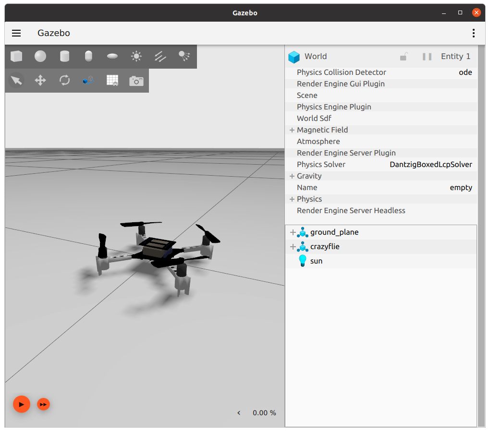

Slide list
1) Why simulation: real data is expensive, crashes break drones and environment, labeling is manual and less accurate. A simulator gives unlimited labeled frames and doesn't require any hardware or data scraping
2) A basic simulator: scene + camera → image + free labels (box, mask). Perfect and clean.
3) Sensor imperfections: image noise and lens distortion.
4) Drone-specific effects: movement, delay, motion blur. 
5) Textures and lighting: the same scene under different walls, floors and light.

Basic noise
Grain (matrcies noise,basically on every camera)
Lens distortion: Straight lines get curved (you can notice this on many of the fpv drone footages)
Lens flare/dirty lens (відблиски)

Drone specific noise

Motion blurr
Rolling shatter (sometimes, it basically is tied to the way the images are processed on some cameras that make it distored in specific way when moving)
Shake
Latency